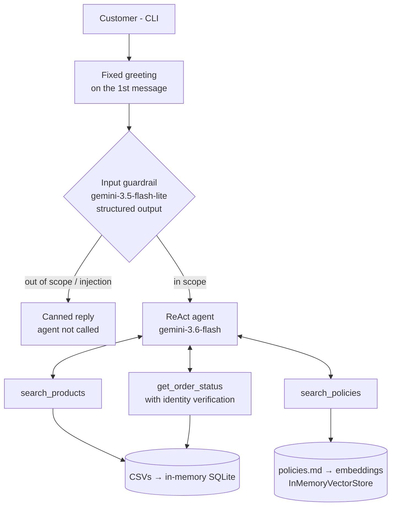

# Empório da Música: virtual customer service assistant

🇧🇷 [Versão em português](README.pt-BR.md)

A conversational agent in Python for **Empório da Música**, a musical instrument store in Campo Grande (MS, Brazil). It serves customers over text, looks up the catalog, promotions and orders in structured data, answers questions about store policies with RAG, and declines out-of-scope topics.

Built as the technical assessment for the AI Engineer position at Artefact.

The agent speaks **Brazilian Portuguese**, the language of the store's customers, so the example conversations are in Portuguese. All documentation is in English. Example (translated):

```
> how much is the Yamaha C40 in 10 installments, and how long is delivery to Dourados?

The Yamaha C40 Nylon Natural costs R$ 599.90 (or R$ 569.90 via PIX, with a 5% discount).
• Installments: from 7x to 12x the minimum installment is R$ 100.00, so 10x is not
  possible. The maximum for this price is up to 6x of R$ 99.98, interest-free.
• Delivery to Dourados: SEDEX 2–5 business days · Jadlog 3–8 · PAC 5–12.
```

In this answer the agent queried the **catalog** (price) and the **policy manual** (installments and shipping) and combined both sources. Full conversation in [`examples/01_produto_parcelamento_frete.md`](examples/01_produto_parcelamento_frete.md).

---

## How to run

Requirements: Python 3.10+ (developed on 3.12) and a free Gemini API key ([Google AI Studio](https://aistudio.google.com/apikey)).

```bash
git clone https://github.com/ThiagoRe4l/ai-eng-artfact.git
cd ai-eng-artfact

python -m venv .venv
source .venv/bin/activate          # Windows (Git Bash): source .venv/Scripts/activate
                                   # Windows (PowerShell): .venv\Scripts\Activate.ps1
pip install -r requirements.txt

cp .env.example .env               # fill in GOOGLE_API_KEY
python main.py                     # type "sair" or press Ctrl+C to quit
```

| Variable | Default | Purpose |
|---|---|---|
| `GOOGLE_API_KEY` | (required) | Gemini API key |
| `AGENT_MODEL_ID` | `google_genai:gemini-3.6-flash` | Main agent (chooses tools and answers) |
| `MODEL_ID` | `google_genai:gemini-3.5-flash-lite` | Input guardrail (classifier) |
| `EMBEDDING_MODEL_ID` | `gemini-embedding-2-preview` | Embeddings for the policy RAG |

Models are loaded with `init_chat_model`, so switching providers only requires changing the variable (e.g. `openai:gpt-...`) and installing the matching package.

**Tests and evaluations**

```bash
python -m pytest                       # unit tests, no API calls
python evals/run_search_eval.py        # product search evaluation with the real model (~40 calls)
python evals/run_guardrail_eval.py     # input classifier evaluation
```

---

## Architecture



```
main.py              CLI (rich), fixed greeting, per-session history
src/
  assistant.py       create_agent + middlewares (guardrail and dynamic prompt)
  prompts.py         system prompt, classifier prompt, greeting
  tools.py           search_products, search_policies, get_order_status
  schemas.py         Pydantic schemas for tool arguments and the classifier
  db.py              loads the CSVs into in-memory SQLite
  rag.py             section-based chunking of the manual + vector store
  guardrails.py      input classifier (before_agent middleware)
data/                original CSVs, PDF manual and its reviewed Markdown version
tests/               unit tests (offline)
evals/               evaluation scripts and reports with the real model
examples/            example conversations
```

---

## Technical decisions

### An agent with tools, not fine-tuning
Stock, promotions and order status change all the time, and the store's own manual forbids giving price, stock or delivery information "without checking the system". A model fine-tuned on the data would freeze that information and answer from memory. The challenge asks for the opposite: knowing **when to look things up**. So the agent uses function calling, with tools that read the data at question time.

### A single agent, plus a separate guardrail
I considered multi-agent frameworks (CrewAI), but a store attendant is a single task. Splitting it into a "products agent" and a "policies agent" would add latency and failure points with no gain. The guardrail is separate because it has a **different responsibility** (validating input, not serving the customer). I used LangChain 1.x `create_agent` on top of LangGraph, with middlewares for the guardrail and the dynamic prompt.

### Structured data in SQL, text in RAG
- **CSVs → in-memory SQLite**, with fixed, parameterized queries. I did not use free-form text-to-SQL: an agent writing SQL could read any customer's data, which the manual (LGPD, Brazil's data protection law) does not allow. With closed tools, leaks are impossible by construction.
- **Calculations in code, not in the model.** Promotional price, PIX price (5% off, not combinable with promotions) and availability reach the agent precomputed.
- **Policy manual → RAG.** A vector store over the products CSV would make the model get prices and stock wrong; putting the manual in SQL makes no sense. Each kind of data gets the right retrieval mechanism.

### Policy RAG
- **The PDF was converted once to Markdown** (`data/policies.md`) and reviewed by hand. This avoids depending on a PDF parser at runtime, keeps tables readable, and makes the normalization fixes visible (see "Data handling").
- **Chunking by section and subsection** (`MarkdownHeaderTextSplitter`), with the heading path at the start of each chunk ("Trocas e Devoluções > Trocas por Defeito"). Without the heading, a chunk saying "up to 30 calendar days" loses the information that it is about returns. The result is 20 chunks of 180 to 870 characters.
- **Sections 7 and 10 were left out of the index.** They are internal staff guidelines, and what matters from them is already in the system prompt. The rule I followed: **behavior goes in the prompt, knowledge goes in RAG.**
- Alternatives considered: the whole manual in the prompt (simple, but makes every call more expensive), a tool with a `Literal` of sections (deterministic, but needs maintenance for every new section), fixed-size chunking (splits tables and rules in half) and semantic chunking (overkill for 8 pages).

### Tool design
- `search_products`: the category is a `Literal` (the model can only pick valid values). Term search is literal and accent-insensitive, scored by matched words; the parameter description tells the model to **send synonyms** ("iniciante estudante começando", i.e. beginner/student/starting). It also has a promotion filter, price sorting and a cap of 8 results. Stock is only shown when the product is available, and an empty category returns an explicit message.
- `get_order_status`: requires **order number + email or phone**. Email alone is not enough: two customers in the dataset share the same email. "Order does not exist" and "details don't match" return the same message, so nobody can discover order numbers by trial and error. The tool returns only the customer's first name.
- `search_policies`: returns the 3 closest chunks.

### Prompt
- Persona and tone follow the manual: informal but professional, like a WhatsApp conversation.
- **Current date and time** are injected by a `@dynamic_prompt` middleware, recomputed on every call. Without it, the agent cannot tell whether the store is open or compute deadlines.
- The date section sits **at the end of the prompt**: the static prefix (persona, rules and tool definitions) stays identical across calls and benefits from Gemini's implicit caching.
- The **introduction greeting is fixed and sent by the code**, not the model, like the automatic message of a WhatsApp channel. Asking the model to "always introduce yourself" produced variations and duplicate greetings.

### Input guardrail
- A classifier with **structured output (Pydantic)** on the lightweight model, with three categories: `in_scope`, `out_of_scope` and `injection_or_abuse`.
- It receives the last 4 turns as context: short replies like "e em 10x?" ("and in 10 installments?") or a phone number only make sense with the previous question.
- When in doubt, it classifies as `in_scope`. Blocking a legitimate customer is worse than letting the agent decline politely.
- **Fail-open:** if the classifier fails (quota, network), the message goes to the agent, which has its own scope rules.
- When it blocks, it returns a canned reply and ends **without calling the agent**, saving the most expensive call.

### Output guardrail
Not implemented at runtime. The search evaluation automatically checks that every R$ amount quoted by the agent exists in the tool results, and it passed all 18 cases. In production the same check would run after each answer (with one retry using the error as feedback, then a fallback), but I chose to spend the challenge time on evaluation and documentation.

### Models
I used the **Gemini free tier** so the project runs at no cost for the reviewer:
- **`gemini-3.6-flash`**, with reasoning, for the agent: deciding *whether* and *which* tool to call is the core of the challenge.
- **`gemini-3.5-flash-lite`** for the classifier: a simple task, lower latency and a separate quota.
- **Groq** was ruled out: the free plan's tokens-per-minute limit is exceeded by the system prompt, history and tool results.
- **Local models (Ollama)** too: they would require gigabytes of downloads, and tool calling in Portuguese is less reliable.

Note: on the free tier, Google may use prompts to improve its products. With fictional data this is not a problem, but with real customer data the paid plan would be mandatory.

---

## Data handling and assumptions

The data has inconsistencies, some probably intentional. What I found and how I handled it:

| Where | Inconsistency | Decision |
|---|---|---|
| `products` | Names don't match descriptions (e.g. "Music Man Bass 1X" described as a Fender Jazz Bass; "Korg Synth 1" described as an 88-key Roland, with specs saying 61) | Data kept as is. When description and specs contradict each other, the agent presents the product and defers the disputed detail to the staff (see "Evaluation") |
| `products` | `active` product with zero stock (96); `discontinued` (113, 136); `coming_soon` (130) | Availability computed in code: available, out of stock, discontinued, coming soon |
| `products` | Product 130 is `coming_soon` but appears as sold in orders 3 and 14 | Kept. It does not affect answers |
| `categories` | Woodwinds, brass and orchestral strings (6, 7, 8) have no products, although the manual says the store sells them | The prompt does not assert categories; the tool explicitly reports empty categories |
| `promotions` | Only 4 active promotions; the Takamine GD20, mentioned in the challenge, has an **inactive** one | Only promotions with `is_active = 1` apply. Expired promotions are disclosed transparently |
| `orders` | Order 3 total (2 × R$ 1,749 = R$ 3,498) recorded as R$ 3,450; order 20 items add up to R$ 1,488 but R$ 1,400 is recorded | The tool does not expose totals, only items, status and delivery |
| `orders` | `pending` and `confirmed` orders are from March 2026 | The prompt says: late or stalled order → don't invent a reason, refer to the staff |
| `customers` | Customers 11 and 43 share the same email | Verification requires order number + email or phone |
| Manual | Two WhatsApp numbers: (67) 3341-4444 and (67) 3321-4500 | WhatsApp = 3321-4500 (section dedicated to the channel); 3341-4444 = phone |
| Manual | Email written with and without an accent | Without the accent (`contato@emporiodamusica.com.br`) |
| Manual | Up to 3 installments "no minimum (except below R$ 50.00)"; the table says "minimum installment R$ 100" for credit | Up to 3x: minimum installment of R$ 50. The detailed rules in section 3.1 prevail over the table |

Fixes to the manual were made in `data/policies.md`; the original PDF remains in `data/`.

---

## Evaluation

Since the agent is not trained, quality is ensured by **evaluation**, in two layers.

**Unit tests** (`tests/`, 34 tests, offline): prompt building, the CLI loop (empty input, `sair`, Ctrl+C), product search rules (promotions, PIX, availability, accents, result cap) and the guardrail with a mocked classifier (block, pass, fail-open and context). Installation was validated in a clean virtual environment using only `requirements.txt`.

**Product search evaluation with the real model** (`evals/run_search_eval.py`): 18 questions written the way real customers write ("violao barato" for "cheap guitar", without accents; "quanto ta o yamaha f310" in casual spelling; "qual o melhor violão? dinheiro não é problema", "what's your best guitar? money is no object"). For each case, the script records the arguments the model passed to the tool, the products returned and the answer, and automatically checks:
1. every R$ amount quoted in the answer exists in the tool output;
2. the expected products were returned.

The first run found real failures, which drove the fixes:
- "which products are on sale?" hit the recursion limit, because there was no promotion filter and the agent searched in a loop → added `on_promotion`.
- "the best guitar" needed 5 searches → added `sort`.
- "do you have a saxophone?" ran 4 searches and claimed the store had woodwinds → explicit message for empty categories and a prompt fix.
- "guitar for beginners" missed products described as "for those who are starting out" → the model is now told to send synonyms.

Result with the final code: **18/18** on both checks. Full report in [`evals/report_search.md`](evals/report_search.md).

The rerun also exposed a limit of the method. The question "88-key keyboard" got opposite answers across runs, because the data contradicts itself: the Korg Synth 1 description says 88 keys and its specs say 61. The model picked a different side each time. I solved it in three prompt iterations, each validated with 3 runs:

1. A rule asking the agent to point out the discrepancy: stable, but exposed internal catalog details to the customer.
2. A rule forbidding exposure of the catalog, describing the expected behavior: only 1 of 3 runs complied, because the model repeated the described conflict.
3. A **template phrase** ("this detail I'd rather confirm with the team...") plus an explicit ban on certain words: **3 of 3**. The agent presents the product with price and PIX price and withholds only the disputed detail.

Lesson: with LLMs, showing the expected phrase works better than describing the behavior. Still, 3 runs are not a guarantee. The deterministic solution is listed under "What I would do with more time".

**Guardrail evaluation** (`evals/run_guardrail_eval.py`): 26 messages on the classifier alone (13 in scope, 6 out of scope and 7 injection or abuse), focused on the boundaries: "which guitar is good for gospel?", "do you sell picks?", "and in 10x?" and a phone number sent as a follow-up, and an angry complaint. Result: **26/26, with no false blocks**. Report in [`evals/report_guardrail.md`](evals/report_guardrail.md).

Honest caveat: some of these cases resemble the examples in the classifier prompt itself, so 100% says little about truly new messages. With more time, I would build a larger set, written by someone else, with no overlap with the prompt.

---

## Example conversations

All are real agent runs, with the model's answers unedited. The conversations are in Portuguese; each file opens with an English summary of what it demonstrates.

| File | What it shows |
|---|---|
| [`01_produto_parcelamento_frete.md`](examples/01_produto_parcelamento_frete.md) | Catalog + policies in the same answer; minimum installment rule |
| [`02_pedido_verificacao_atraso.md`](examples/02_pedido_verificacao_atraso.md) | Identity verification and an order with an overdue delivery |
| [`03_promocoes_pix.md`](examples/03_promocoes_pix.md) | Expired promotion, and a promotion that does not stack with the PIX discount |
| [`04_guardrails_privacidade.md`](examples/04_guardrails_privacidade.md) | Out-of-scope request, prompt injection and an attempt to see someone else's order |
| [`05_recomendacao_estoque_troca.md`](examples/05_recomendacao_estoque_troca.md) | Beginner recommendation, out-of-stock product and return policy |

---

## Limitations

- **In-memory history only:** the conversation is lost when the CLI closes.
- **Holidays:** the prompt has no calendar. The model recognized a national holiday (Finados) on its own, but this is not guaranteed.
- **Literal product search:** it depends on the model sending good synonyms; there is no semantic search over descriptions.
- **The policy index is rebuilt** on every run (one embeddings call; irrelevant with 20 chunks, but it does not scale).
- **Static data:** the CSVs are loaded at startup. In a real system the tools would query a live API or database, without changing the agent interface.
- **The input guardrail adds one call** (to the lightweight model) per message.
- **Complaints are not recorded:** there is no tool for it, so the agent directs the customer to the staff instead of pretending to record it.
- **Free tier:** subject to rate limits; with many messages in a row, the API may respond with 429.

## What I would do with more time

- A runtime output guardrail, reusing the price check from the evaluation.
- Flag products with conflicting description and specs during preprocessing (the tool would return something like `"confirm_with_staff": ["keys"]`), without relying on the model to notice the conflict.
- Persistent history (`langgraph-checkpoint-sqlite`) and automatic summarization of long conversations.
- Hybrid product search (embeddings over descriptions + SQL filters).
- A vector index persisted to disk.
- An API (FastAPI) and integration with a real channel such as WhatsApp, with handoff to a human agent.
- A tool to record complaints, and a holiday calendar.
- Observability with tracing (LangSmith) and the evaluations running in CI.

---

## How I used AI assistants

Before talking about tools, it's worth saying where the foundation of this project came from. The agent's structure follows what I studied in my postgraduate program in AI and Automation: I revisited the course lessons and materials on configuring and building agents with LangChain (`create_agent`, tools, middlewares and checkpointer) to put together each step, which is why I chose LangChain over other frameworks. I also brought experience from my last job working with automation and AI agents. It directly shaped one choice: converting the store manual from PDF to reviewed Markdown instead of parsing the PDF at runtime, because PDF interpretation was one of the most recurring problems in the projects I worked on.

On top of that foundation, I used AI at every stage, with well-defined roles:

- **Claude (chat):** reading the challenge and the data, surveying the inconsistencies, discussing architecture (fine-tuning vs. tools, multi-agent vs. single agent, chunking strategies), researching the free Gemini models, and drafting code (data layer, tools, RAG, guardrail), the system prompt, the Markdown conversion of the manual and this README.
- **Claude Code:** unit tests, evaluation scripts, running the evaluations and generating the example conversations. It worked under rules written in [`CLAUDE.md`](CLAUDE.md): no commits, save calls on the free API tier, and do not change the main code without asking.
- **Me:** final decisions, integrating and reviewing all the code, manual testing through the CLI, and every commit. Some decisions came from me: using LangChain based on what I learned in my postgraduate program, a guardrail separate from the agent, a fixed greeting sent by the code, and testing search robustness with varied phrasings.

What worked well was using AI to **generate and critique** at the same time. The evaluation written by Claude Code found tool failures that neither I nor Claude (chat) had anticipated, and each failure became a fix with documented before-and-after results. It also found a real CLI bug on Windows: replies containing emoji crashed the cp1252 console.

About the commit history: only the system prompt commit carries `Co-Authored-By`. In all others, AI-suggested code was reviewed, adjusted and tested by me before committing. The split of roles is described in this section.
