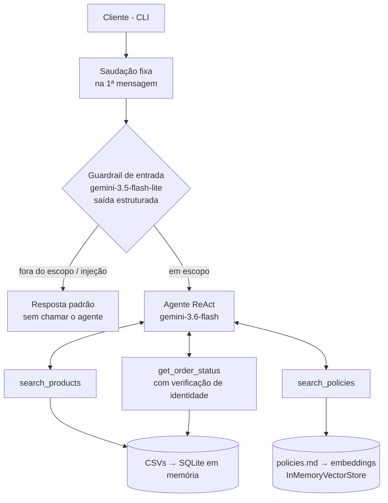

# Empório da Música: assistente virtual de atendimento

🇺🇸 [English version](README.md)

Agente conversacional em Python para a **Empório da Música**, loja de instrumentos musicais em Campo Grande (MS). Ele atende clientes por texto, consulta catálogo, promoções e pedidos em dados estruturados, responde dúvidas sobre as políticas da loja com RAG e recusa assuntos fora do escopo.

Desenvolvido como teste técnico para a vaga de AI Engineer na Artefact.

```
> quanto fica o Yamaha C40 em 10x e qual o prazo de entrega para Dourados?

O Yamaha C40 Nylon Natural está de R$ 599,90 (ou R$ 569,90 no PIX com 5% de desconto).
• Parcelamento: entre 7x e 12x a parcela mínima é de R$ 100,00, então não é possível
  fazer em 10x. O máximo para esse valor é em até 6x de R$ 99,98 sem juros.
• Prazo para Dourados: SEDEX 2 a 5 dias úteis · Jadlog 3 a 8 · PAC 5 a 12.
```

Nessa resposta, o agente consultou o **catálogo** (preço) e o **manual de políticas** (parcelamento e frete) e cruzou as duas fontes. Conversa completa em [`examples/01_produto_parcelamento_frete.md`](examples/01_produto_parcelamento_frete.md).

---

## Como rodar

Pré-requisitos: Python 3.10+ (desenvolvido em 3.12) e uma chave gratuita da API do Gemini ([Google AI Studio](https://aistudio.google.com/apikey)).

```bash
git clone https://github.com/ThiagoRe4l/ai-eng-artfact.git
cd ai-eng-artfact

python -m venv .venv
source .venv/bin/activate          # Windows (Git Bash): source .venv/Scripts/activate
                                   # Windows (PowerShell): .venv\Scripts\Activate.ps1
pip install -r requirements.txt

cp .env.example .env               # preencha GOOGLE_API_KEY
python main.py                     # digite "sair" ou Ctrl+C para encerrar
```

| Variável | Padrão | Uso |
|---|---|---|
| `GOOGLE_API_KEY` | (obrigatória) | Chave da API do Gemini |
| `AGENT_MODEL_ID` | `google_genai:gemini-3.6-flash` | Agente principal (decide as tools e responde) |
| `MODEL_ID` | `google_genai:gemini-3.5-flash-lite` | Guardrail de entrada (classificador) |
| `EMBEDDING_MODEL_ID` | `gemini-embedding-2-preview` | Embeddings do RAG de políticas |

Os modelos são carregados com `init_chat_model`, então trocar de provedor é só mudar a variável (por exemplo, `openai:gpt-...`) e instalar o pacote correspondente.

**Testes e avaliações**

```bash
python -m pytest                       # testes unitários, sem chamadas à API
python evals/run_search_eval.py        # avaliação da busca com o modelo real (~40 chamadas)
python evals/run_guardrail_eval.py     # avaliação do classificador de entrada
```

---

## Arquitetura



```
main.py              CLI (rich), saudação fixa, histórico por sessão
src/
  assistant.py       create_agent + middlewares (guardrail e prompt dinâmico)
  prompts.py         system prompt, prompt do classificador, saudação
  tools.py           search_products, search_policies, get_order_status
  schemas.py         schemas Pydantic dos argumentos das tools e do classificador
  db.py              carga dos CSVs em SQLite em memória
  rag.py             chunking por seção do manual + vector store
  guardrails.py      classificador de entrada (middleware before_agent)
data/                CSVs originais, manual em PDF e versão revisada em Markdown
tests/               testes unitários (offline)
evals/               scripts e relatórios de avaliação com o modelo real
examples/            conversas de exemplo
```

---

## Decisões técnicas

### Agente com tools, não fine-tuning
Estoque, promoções e status de pedido mudam o tempo todo, e o próprio manual da loja proíbe informar preço, estoque ou prazo "sem consultar o sistema". Um modelo treinado com os dados congelaria essas informações e responderia de memória. O desafio pede exatamente o contrário: saber **quando consultar**. Por isso, o agente usa function calling com tools que leem os dados no momento da pergunta.

### Um agente só, mais um guardrail separado
Avaliei frameworks multiagente (CrewAI), mas um atendente de loja é uma tarefa só. Dividir em "agente de produtos" e "agente de políticas" adicionaria latência e pontos de falha sem ganho. O guardrail é separado porque tem **outra responsabilidade** (validar a entrada, não atender). Usei o `create_agent` do LangChain 1.x sobre o LangGraph, com middlewares para o guardrail e para o prompt dinâmico.

### Dados estruturados em SQL, texto em RAG
- **CSVs → SQLite em memória**, com consultas fixas e parametrizadas. Não usei text-to-SQL livre: um agente gerando SQL poderia consultar dados de qualquer cliente, o que o manual (seção de LGPD) não permite. Com tools fechadas, o vazamento fica impossível por construção.
- **Cálculos em código, não no modelo.** Preço com promoção, preço no PIX (5%, que não acumula com promoção) e disponibilidade já chegam prontos para o agente.
- **Manual de políticas → RAG.** Colocar um vector store sobre o CSV de produtos faria o modelo errar preço e estoque; colocar o manual em SQL não faz sentido. Cada tipo de dado tem o mecanismo de busca adequado.

### RAG das políticas
- **O PDF foi convertido uma vez para Markdown** (`data/policies.md`) e revisado à mão. Isso evita depender de parser de PDF em tempo de execução, mantém as tabelas legíveis e deixa visíveis os ajustes de normalização (ver "Tratamento dos dados").
- **Chunking por seção e subseção** (`MarkdownHeaderTextSplitter`), com o caminho do título no início de cada chunk ("Trocas e Devoluções > Trocas por Defeito"). Sem o título, o chunk "até 30 dias corridos" perde a referência de que trata de trocas. O resultado são 20 chunks de 180 a 870 caracteres.
- **As seções 7 e 10 ficaram fora do índice.** São diretrizes internas da equipe; o que importa delas já está no system prompt. A regra que segui: **comportamento vai no prompt, conhecimento vai no RAG.**
- Alternativas consideradas: manual inteiro no prompt (simples, mas encarece todas as chamadas), tool com um `Literal` de seções (determinística, mas exige manutenção a cada seção nova), chunking por tamanho fixo (corta tabelas e regras no meio) e chunking semântico (exagerado para 8 páginas).

### Desenho das tools
- `search_products`: a categoria é um `Literal` (o modelo só escolhe valores válidos). A busca por termo é literal e sem acento, com pontuação por palavras encontradas; a descrição do parâmetro orienta o modelo a **enviar sinônimos** ("iniciante estudante começando"). Também tem filtro de promoção, ordenação por preço e no máximo 8 resultados. O estoque só aparece quando o produto está disponível, e categoria sem produtos devolve uma mensagem explícita.
- `get_order_status`: exige **número do pedido + e-mail ou telefone**. Só e-mail não basta: dois clientes da base têm o mesmo e-mail. "Pedido não existe" e "dados não batem" têm a mesma resposta, para ninguém descobrir números de pedido por tentativa. A tool devolve só o primeiro nome do cliente.
- `search_policies`: devolve os 3 chunks mais próximos.

### Prompt
- Persona e tom seguem o manual: informal, mas profissional, como em uma conversa de WhatsApp.
- **Data e hora atuais** entram via middleware `@dynamic_prompt`, recalculado a cada chamada. Sem isso, o agente não sabe se a loja está aberta nem calcula prazos.
- A seção com a data fica **no fim do prompt**: o prefixo estático (persona, regras e definição das tools) continua idêntico entre chamadas e aproveita o cache implícito do Gemini.
- A **saudação de apresentação é fixa e enviada pelo código**, não pelo modelo, como a mensagem automática de um canal de WhatsApp. Pedir ao modelo para "sempre se apresentar" gerava variações e saudações duplicadas.

### Guardrail de entrada
- Classificador com **saída estruturada (Pydantic)** no modelo leve, em três categorias: `in_scope`, `out_of_scope` e `injection_or_abuse`.
- Recebe as últimas 4 falas como contexto: respostas curtas como "e em 10x?" ou um número de telefone só fazem sentido com a pergunta anterior.
- Na dúvida, classifica como `in_scope`. Bloquear um cliente legítimo é pior do que deixar o agente recusar com educação.
- **Fail-open:** se o classificador falhar (cota, rede), a mensagem segue para o agente, que tem as próprias regras de escopo.
- Quando bloqueia, devolve uma resposta pronta e encerra **sem chamar o agente**, o que economiza a chamada mais cara.

### Guardrail de saída
Não implementei em tempo de execução. A avaliação da busca verifica automaticamente se todo valor em R$ citado pelo agente existe no retorno das tools, e passou nos 18 casos. Em produção, essa mesma checagem rodaria depois de cada resposta (com uma nova tentativa usando o erro como feedback e, em seguida, um fallback), mas preferi investir o tempo do desafio em avaliação e documentação.

### Modelos
Usei o **free tier do Gemini** para que o projeto rode sem custo para quem avaliar:
- **`gemini-3.6-flash`**, com raciocínio, no agente: decidir *se* e *qual* tool chamar é o núcleo do desafio.
- **`gemini-3.5-flash-lite`** no classificador: tarefa simples, menor latência e cota separada.
- **Groq** foi descartado: o limite de tokens por minuto do plano gratuito estoura com system prompt, histórico e resultados de tools.
- **Modelos locais (Ollama)** também: exigiriam download de gigabytes e o tool calling em português é menos confiável.

Observação: no free tier, o Google pode usar os prompts para melhorar seus produtos. Com dados fictícios isso não é problema, mas, com dados reais de clientes, seria obrigatório usar o plano pago.

---

## Tratamento dos dados e suposições

Os dados têm inconsistências, algumas provavelmente intencionais. O que encontrei e como tratei:

| Onde | Inconsistência | Decisão |
|---|---|---|
| `products` | Nomes não batem com a descrição (ex.: "Music Man Bass 1X" descrito como Fender Jazz Bass; "Korg Synth 1" descrito como Roland de 88 teclas, com specs de 61) | Dados mantidos como estão. Quando descrição e specs se contradizem, o agente apresenta o produto e encaminha o detalhe em conflito à equipe (ver "Avaliação") |
| `products` | Produto `active` com estoque 0 (96); `discontinued` (113, 136); `coming_soon` (130) | Disponibilidade calculada em código: "disponível", "sem estoque", "descontinuado" e "em breve" |
| `products` | Produto 130 está `coming_soon`, mas aparece vendido nos pedidos 3 e 14 | Mantido. Não afeta as respostas |
| `categories` | Sopros e cordas orquestrais (6, 7, 8) não têm produtos, mas o manual diz que a loja vende | O prompt não afirma categorias; a tool informa explicitamente quando a categoria está vazia |
| `promotions` | Só 4 promoções ativas; o Takamine GD20, citado no enunciado, tem promoção **inativa** | Só promoções com `is_active = 1` são aplicadas. Promoção encerrada é informada com transparência |
| `orders` | Total do pedido 3 (2 × R$ 1.749 = R$ 3.498) registrado como R$ 3.450; pedido 20 soma R$ 1.488 e registra R$ 1.400 | A tool não expõe o total, só itens, status e entrega |
| `orders` | Pedidos `pending` e `confirmed` são de março de 2026 | O prompt orienta: pedido atrasado ou parado → não inventar motivo, encaminhar à equipe |
| `customers` | Clientes 11 e 43 com o mesmo e-mail | Verificação exige número do pedido + e-mail ou telefone |
| Manual | Dois WhatsApps: (67) 3341-4444 e (67) 3321-4500 | WhatsApp = 3321-4500 (seção dedicada ao canal); 3341-4444 = telefone |
| Manual | E-mail com e sem acento | Sem acento (`contato@emporiodamusica.com.br`) |
| Manual | Parcelamento até 3x "sem valor mínimo (exceto abaixo de R$ 50,00)"; tabela diz "parcela mínima de R$ 100" para o crédito | Até 3x: parcela mínima de R$ 50. As regras detalhadas da seção 3.1 prevalecem sobre a tabela |

Os ajustes no manual foram feitos em `data/policies.md`; o PDF original continua em `data/`.

---

## Avaliação

Como o agente não é treinado, a qualidade é garantida por **avaliação**, em duas camadas.

**Testes unitários** (`tests/`, 34 testes, sem rede): construção do prompt, loop da CLI (entrada vazia, `sair`, Ctrl+C), regras da busca de produtos (promoção, PIX, disponibilidade, acentos, limite de resultados) e guardrail com classificador simulado (bloqueio, passagem, fail-open e contexto). A instalação foi validada num ambiente virtual limpo, só com o `requirements.txt`.

**Avaliação da busca com o modelo real** (`evals/run_search_eval.py`): 18 perguntas escritas como clientes reais escrevem ("violao barato", "quanto ta o yamaha f310", "qual o melhor violão? dinheiro não é problema"). Para cada caso, o script registra os argumentos que o modelo passou à tool, os produtos retornados e a resposta, e checa automaticamente:
1. todo valor em R$ citado na resposta existe no retorno da tool;
2. os produtos esperados foram retornados.

A primeira rodada encontrou falhas reais, que guiaram as correções:
- "quais produtos estão em promoção?" estourou o limite de recursão, porque não existia filtro de promoção e o agente buscava em loop → adicionei `on_promotion`.
- "o melhor violão" exigiu 5 buscas → adicionei `sort`.
- "vocês têm saxofone?" fez 4 buscas e afirmou que a loja tinha sopros → mensagem explícita para categoria vazia e ajuste no prompt.
- "violão para iniciante" perdia produtos descritos como "para quem está começando" → orientação para o modelo enviar sinônimos.

Resultado com o código final: **18/18** nas duas checagens. Relatório completo em [`evals/report_search.md`](evals/report_search.md).

A reexecução também mostrou um limite do método. A pergunta "teclado de 88 teclas" teve respostas opostas entre rodadas, porque o próprio dado se contradiz: a descrição do Korg Synth 1 diz 88 teclas, e o specs diz 61. O modelo escolhia um lado diferente a cada vez. Resolvi em três iterações do prompt, cada uma validada com 3 execuções:

1. Regra pedindo para apontar a divergência: estável, mas expunha ao cliente detalhes internos do cadastro.
2. Regra proibindo expor o cadastro, descrevendo o comportamento esperado: apenas 1 de 3 execuções seguiu a regra, porque o modelo repetia o conflito descrito.
3. **Frase-modelo** ("esse detalhe eu prefiro confirmar com a equipe...") mais proibição explícita de termos: **3 de 3**. O agente apresenta o produto com preço e PIX e retém só o detalhe em conflito.

Lição: com LLMs, mostrar a frase esperada funciona melhor do que descrever o comportamento. Ainda assim, 3 execuções não são garantia. A solução determinística está em "O que eu faria com mais tempo".

**Avaliação do guardrail** (`evals/run_guardrail_eval.py`): 26 mensagens só no classificador (13 em escopo, 6 fora do escopo e 7 de injeção ou abuso), com foco nas fronteiras: "qual violão pra gospel?", "vocês vendem palheta?", "e em 10x?" e um número de telefone enviados como continuação da conversa, e uma reclamação irritada. Resultado: **26/26, sem nenhum falso bloqueio**. Relatório em [`evals/report_guardrail.md`](evals/report_guardrail.md).

Ressalva honesta: parte desses casos se parece com os exemplos do próprio prompt do classificador, então 100% prova pouco sobre mensagens realmente novas. Com mais tempo, eu montaria um conjunto maior, escrito por outra pessoa e sem sobreposição com o prompt.

---

## Conversas de exemplo

| Arquivo | O que mostra |
|---|---|
| [`01_produto_parcelamento_frete.md`](examples/01_produto_parcelamento_frete.md) | Catálogo + políticas na mesma resposta; regra de parcela mínima |
| [`02_pedido_verificacao_atraso.md`](examples/02_pedido_verificacao_atraso.md) | Verificação de identidade e pedido com entrega atrasada |
| [`03_promocoes_pix.md`](examples/03_promocoes_pix.md) | Promoção encerrada e promoção que não acumula com o PIX |
| [`04_guardrails_privacidade.md`](examples/04_guardrails_privacidade.md) | Fora do escopo, prompt injection e tentativa de ver pedido de outra pessoa |
| [`05_recomendacao_estoque_troca.md`](examples/05_recomendacao_estoque_troca.md) | Recomendação para iniciante, produto sem estoque e política de troca |

Todas são execuções reais do agente, sem edição das respostas.

---

## Limitações

- **Histórico só em memória:** a conversa é perdida ao fechar a CLI.
- **Feriados:** o prompt não tem calendário. O modelo reconheceu Finados sozinho, mas isso não é garantido.
- **Busca de produtos literal:** depende do modelo enviar bons sinônimos; não há busca semântica nas descrições.
- **Índice de políticas recalculado** a cada execução (uma chamada de embeddings; irrelevante com 20 chunks, mas não escala).
- **Dados estáticos:** os CSVs são carregados na inicialização. Num sistema real, as tools consultariam uma API ou um banco ao vivo, sem mudar a interface com o agente.
- **O guardrail de entrada adiciona uma chamada** (do modelo leve) por mensagem.
- **Reclamações não são registradas:** não há tool para isso, e o agente orienta o contato com a equipe em vez de fingir que registrou.
- **Free tier:** sujeito a limites de requisição; com muitas mensagens seguidas, a API pode responder com 429.

## O que eu faria com mais tempo

- Guardrail de saída em tempo de execução, reaproveitando a checagem de preços da avaliação.
- Marcar no pré-processamento os produtos com descrição e specs conflitantes (a tool devolveria algo como `"confirm_with_staff": ["teclas"]`), sem depender do modelo perceber o conflito.
- Histórico persistente (`langgraph-checkpoint-sqlite`) e resumo automático de conversas longas.
- Busca híbrida de produtos (embeddings das descrições + filtros SQL).
- Índice vetorial persistido em disco.
- API (FastAPI) e integração com um canal real, como o WhatsApp, com transferência para atendente humano.
- Tool para registrar reclamações e calendário de feriados.
- Observabilidade com tracing (LangSmith) e as avaliações rodando em CI.

---

## Como usei assistentes de IA

Antes de falar das ferramentas, vale dizer de onde veio a base do projeto. A estrutura do agente segue o que estudei na pós-graduação em IA e Automação: revisitei as aulas e a documentação do curso sobre configuração e criação de agentes com LangChain (`create_agent`, tools, middlewares e checkpointer) para montar cada etapa, e por isso escolhi o LangChain em vez de outros frameworks. Também trouxe a experiência do meu último trabalho com automação e agentes de IA. Ela pesou diretamente em uma escolha: converter o manual da loja de PDF para Markdown revisado, em vez de ler o PDF em tempo de execução, porque a interpretação de PDFs era um dos problemas mais recorrentes nos projetos em que atuei.

Sobre essa base, usei IA em todas as etapas, com papéis bem definidos:

- **Claude (chat):** leitura do enunciado e dos dados, levantamento das inconsistências, discussão de arquitetura (fine-tuning × tools, multiagente × agente único, estratégias de chunking), pesquisa sobre os modelos gratuitos do Gemini e rascunhos de código (camada de dados, tools, RAG, guardrail), do system prompt, da conversão do manual para Markdown e deste README.
- **Claude Code:** testes unitários, scripts de avaliação, execução das avaliações e geração das conversas de exemplo. Ele trabalhou com regras escritas no [`CLAUDE.md`](CLAUDE.md): não fazer commits, economizar chamadas da API gratuita e não alterar o código principal sem pedir.
- **Eu:** decisões finais, integração e revisão de todo o código, testes manuais pela CLI e todos os commits. Algumas decisões partiram de mim: usar LangChain com base no que aprendi na pós, criar um guardrail separado do agente, enviar uma saudação fixa pelo código e testar a robustez da busca com frases variadas.

O que funcionou bem foi usar a IA para **gerar e criticar** ao mesmo tempo. A avaliação escrita pelo Claude Code encontrou falhas nas tools que eu e o Claude (chat) não tínhamos previsto, e cada falha virou uma correção com antes e depois documentados. Ele também encontrou um bug real da CLI no Windows: respostas com emoji quebravam no console cp1252.

Sobre o histórico: só o commit do system prompt tem `Co-Authored-By`. Nos demais, o código sugerido pela IA foi revisado, ajustado e testado por mim antes do commit. A divisão de papéis está descrita nesta seção.
